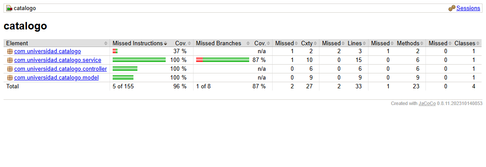
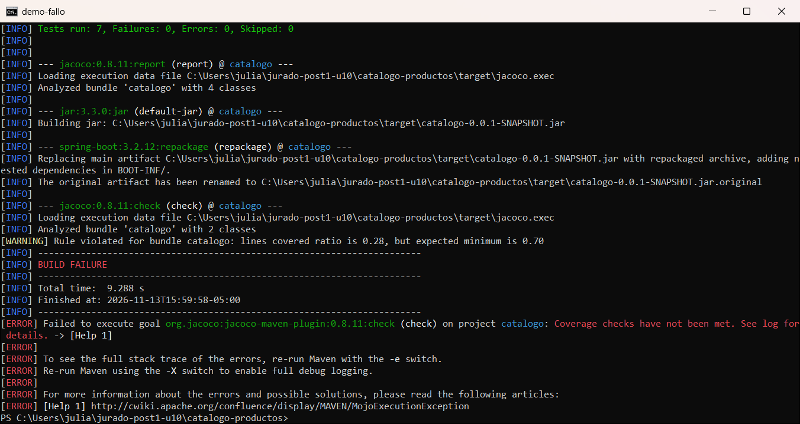
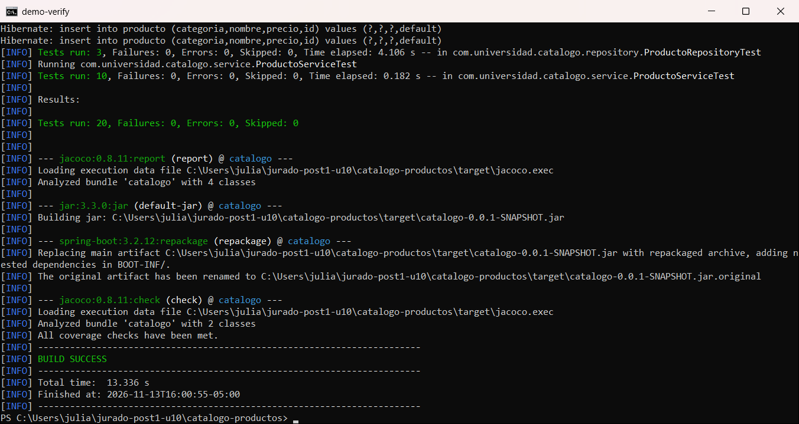
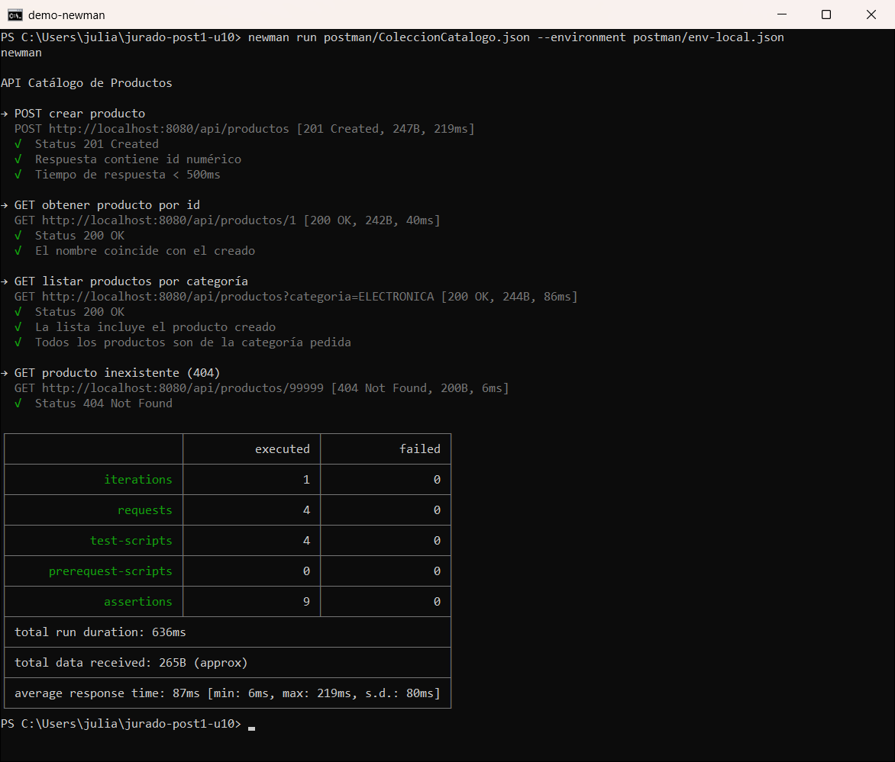

# Post-contenido Unidad 10: pruebas de software en aplicaciones web

## Descripción
Repositorio del laboratorio de la Unidad 10 de Programación Web (séptimo semestre). Contiene un único proyecto Maven Spring Boot, `catalogo-productos/`, con una suite de pruebas automatizadas sobre un catálogo de productos pequeño: crear un producto, consultarlo por id, listarlos por categoría y actualizar su precio. La Parte 1 prueba el servicio con JUnit 5 y Mockito, y el repositorio con `@DataJpaTest` sobre H2. La Parte 2 agrega pruebas de la capa web con `@WebMvcTest`, una colección Postman ejecutable con Newman y un umbral de cobertura con JaCoCo que hace fallar el build.

## Estructura del proyecto
```
catalogo-productos/
├── src/main/java/com/universidad/catalogo/
│   ├── CatalogoApplication.java
│   ├── model/Producto.java
│   ├── repository/ProductoRepository.java
│   ├── service/ProductoService.java
│   └── controller/ProductoController.java
└── src/test/java/com/universidad/catalogo/
    ├── service/ProductoServiceTest.java
    ├── repository/ProductoRepositoryTest.java
    └── controller/ProductoControllerTest.java
postman/
├── ColeccionCatalogo.json
└── env-local.json
capturas/
```

## Qué prueba cada clase y por qué
| Clase de prueba | Herramienta | Qué verifica | Por qué esta herramienta |
|---|---|---|---|
| `ProductoServiceTest` | JUnit 5 y Mockito (`@Mock`, `@InjectMocks`) | La lógica de negocio: validaciones, la excepción cuando un producto no existe y el cálculo de lo que se guarda. | La lógica de `ProductoService` no depende de la base de datos. Con el repositorio simulado la prueba es instantánea y falla solo por un error de la lógica. |
| `ProductoRepositoryTest` | `@DataJpaTest` con `TestEntityManager` sobre H2 | La consulta derivada `findByCategoria` y la restricción `@NotBlank` de la entidad. | Una consulta solo se comprueba contra una base de datos real. `@DataJpaTest` carga únicamente la capa de persistencia y revierte los cambios entre pruebas. |
| `ProductoControllerTest` | `@WebMvcTest`, `MockMvc` y `@MockBean` | Rutas, códigos de estado (200, 201, 400 y 404) y el JSON de respuesta. | Arranca solo la capa web y simula las peticiones sin abrir un puerto. El servicio se reemplaza por un doble, porque su lógica ya se probó aparte. |
| `postman/ColeccionCatalogo.json` | Postman y Newman | El contrato HTTP completo contra la aplicación en ejecución, con su base de datos H2 real. | Prueba la aplicación como una caja negra, fuera de la JVM y de Maven. Es lo que usaría un equipo de QA o un consumidor externo de la API. |

## Orden en que se agregaron las pruebas
1. Pruebas unitarias del servicio, la capa con más lógica y la más barata de probar.
2. Pruebas de integración del repositorio, para validar las consultas contra H2.
3. Pruebas de la capa web, cuando el controlador ya existía.
4. La colección Postman, que recorre la aplicación completa.
5. JaCoCo, al final. Con la suite de las tres capas completa, el umbral mide el estado real del proyecto.

## Parte 1: pruebas unitarias y de integración
`ProductoServiceTest` cubre el caso feliz y los casos de error: precio negativo, nombre vacío, producto inexistente y precio inválido al actualizar. Cuando una validación rechaza el dato, la prueba comprueba además que el repositorio nunca recibió la llamada a `save`. `ProductoRepositoryTest` inserta dos productos de categorías distintas antes de cada prueba y verifica la búsqueda con y sin coincidencias.

## Parte 2: capa web, Postman y cobertura
`ProductoControllerTest` cubre un 200 con el producto, un 404 por id inexistente, un 201 al crear y un 400 por datos inválidos. La colección Postman tiene cuatro peticiones en orden: crear un producto, obtenerlo por id, listarlo por categoría y pedir uno inexistente. Cada una trae sus scripts de prueba. JaCoCo exige un 70% de cobertura de líneas sobre servicio y controlador, y `mvn verify` falla si no se alcanza.

Cobertura de la ejecución final: servicio y controlador al 100% de líneas. El reporte HTML también cuenta el modelo y la clase principal, y muestra un 96% de instrucciones y un 87% de ramas. La clase principal queda en el 37%, y el umbral la excluye.

## Decisiones de diseño
Parte 1
1. H2 se usa tanto en la ejecución local como en las pruebas. El objetivo de la unidad es escribir pruebas, y montar un motor de base de datos externo solo agregaría trabajo de infraestructura.
2. `buscarPorId` lanza `EntityNotFoundException` en vez de devolver `null`. El contrato del método es explícito y se verifica con `assertThrows`, sin que cada llamador tenga que acordarse de revisar un `null`.
3. `@DataJpaTest` en lugar de `@SpringBootTest` para el repositorio. Aísla la prueba a la persistencia. Aquí la diferencia de tiempo es pequeña, pero en un proyecto con decenas de beans la suite se haría mucho más lenta.

Parte 2
4. `@WebMvcTest` en lugar de `@SpringBootTest` con `TestRestTemplate`. Esta última levantaría también la persistencia real para probar algo que ya cubren las pruebas de servicio y repositorio. Así se evita duplicar cobertura.
5. La colección Postman es un archivo `.json` versionado y no una clase JUnit. Prueba el contrato HTTP completo, con serialización, códigos y cabeceras, contra un proceso real.
6. JaCoCo se configuró al cierre de la Parte 2. Con solo las pruebas del servicio, el umbral habría medido una parte pequeña del código y daría una falsa sensación de cumplimiento.
7. Este laboratorio no incluye Selenium WebDriver. `ProductoController` es una API REST que devuelve JSON y no hay ninguna vista HTML. Crear una página solo para tener algo que automatizar introduciría una capa de presentación ficticia. Selenium con Page Object Model tendría sentido en un proyecto con vistas, por ejemplo una aplicación con formularios Thymeleaf. Aquí, la colección Postman cumple el rol de prueba de extremo a extremo sobre la superficie que realmente expone la aplicación.

## Ajustes sobre el enunciado
Estos cambios no están en el enunciado y se hicieron al probar el código.
- Se agregó `spring-boot-starter-validation` al `pom.xml`. La entidad `Producto` usa `@NotBlank`, y sin esa dependencia no compila.
- `ProductoService.crear` pone el `id` en `null` antes de guardar. Si el cliente enviaba un `id` existente en el JSON, `save()` actualizaba ese producto en lugar de crear uno nuevo.
- Se agregaron 7 pruebas a las que pide el enunciado: 6 en `ProductoServiceTest`, 1 en `ProductoRepositoryTest` y 3 en `ProductoControllerTest`, para cubrir caminos que quedaban sin probar, entre ellos el `id` enviado por el cliente. El enunciado pide 4, 2 y 4 pruebas respectivamente.
- La demostración de que el umbral falla se hizo ejecutando `verify` solo con las pruebas web (`-Dtest=ProductoControllerTest`), y no comentando esa clase. Con las pruebas adicionales del servicio, comentar `ProductoControllerTest` deja la cobertura en un 71%, todavía sobre el umbral. Sin las pruebas del servicio la cobertura cae al 28% y el build falla.
- No se usó el Runner de Postman. El Runner y la importación de archivos exigen iniciar sesión, y se prefirió no crear una cuenta solo para la captura. La misma colección se ejecutó con Newman, que corre los mismos scripts y da el mismo resultado: 4 peticiones, 9 verificaciones y 0 fallos.
- Spring Boot es la 3.2.12, porque start.spring.io ya no ofrece ninguna 3.x.

## Cómo compilar y ejecutar
Requisitos: JDK 17 o superior. Maven viene incluido con el wrapper `mvnw`. Para Newman, Node.js 18 o superior.

1. Clonar el repositorio: `git clone https://github.com/julianejurado-rgb/jurado-post1-u10.git`
2. Entrar al proyecto: `cd jurado-post1-u10/catalogo-productos`
3. Ejecutar las pruebas con verificación de cobertura: `./mvnw clean verify` (en Windows, `.\mvnw.cmd clean verify`). El reporte queda en `target/site/jacoco/index.html`.
4. Para ver el umbral fallar, ejecutar solo las pruebas web: `./mvnw clean verify -Dtest=ProductoControllerTest`
5. Arrancar la aplicación: `./mvnw spring-boot:run`. Queda en `http://localhost:8080`, con datos en H2 en memoria.
6. Con la aplicación en marcha, desde la raíz del repositorio, ejecutar la colección: `npm install -g newman` y después `newman run postman/ColeccionCatalogo.json --environment postman/env-local.json`

## Capturas de pantalla
Reporte de cobertura de JaCoCo, con el servicio y el controlador al 100%:



Build fallando por cobertura insuficiente, con la cobertura en 0,28 frente al mínimo de 0,70:



Las 20 pruebas (servicio, repositorio y web) en verde, con la verificación de cobertura superada:



Colección Postman ejecutada con Newman contra la aplicación en marcha, con 0 fallos:


